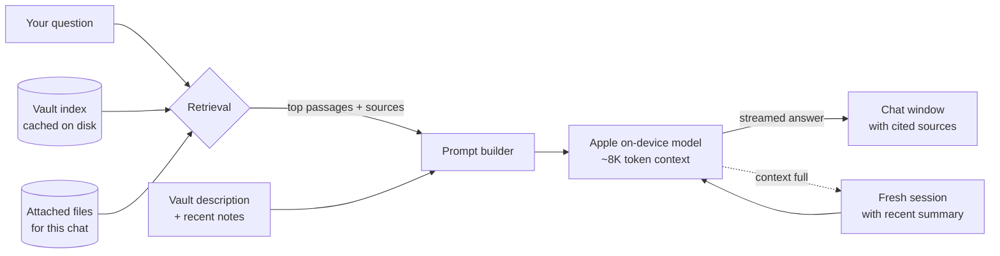

# MChat

**A private AI chat app for Mac that runs entirely on-device, using Apple's Foundation Models, and answers from your own notes and documents with cited sources.**

Nothing you type, attach, or index leaves your Mac. There is no cloud fallback and no telemetry, and no account is needed.

---

## Why I built it

Apple ships a capable language model on every Apple Intelligence Mac, but it is small. Its context window is about 8,000 tokens, which fills up after roughly ten exchanges, and it knows little about your own world. MChat is an experiment in getting real work out of a small, private model with three techniques:

1. **Retrieval instead of memory.** Rather than stuffing whole documents into the model, MChat searches your notes and files and sends only the few most relevant passages with each question.
2. **Managed context.** A live memory meter shows how full the context window is. When it overflows, the app starts a fresh session that carries over a short summary of recent turns instead of failing.
3. **Traceability.** Every answer lists the notes or files it drew from, and the full prompt sent to the model is logged, so any answer can be checked against its sources.

## Features

- **Native Mac chat app** built in SwiftUI with Liquid Glass styling, streaming replies, Stop (Esc), and copy buttons
- **Saved conversations** in a sidebar, with search and rename (stored locally with SwiftData)
- **Obsidian or plain-text vault search.** Connect a folder of `.md`/`.txt` notes once, and it is remembered between launches
- **Hybrid retrieval:** keyword scoring (TF-IDF) combined with on-device semantic embeddings, so both exact terms and synonyms match
- **Incremental index.** The vault index is cached to disk, and only new or edited notes are re-embedded, in the background with a progress bar
- **Recency awareness.** "Where did I leave off?" questions pull in the most recently edited notes
- **Attach files to a chat:** drag in PDF, Word, Markdown, or text files, which are searched the same way as the vault
- **Source citations** under every answer that used notes or files
- **Accurate memory meter** using the model's own token counter
- **Plain-English error handling** for model refusals, safety-filter blocks, timeouts, and context overflow

## How it works

| Component | File | Role |
|---|---|---|
| Chat screen | `ChatView.swift` | Builds prompts, streams answers, handles stop and overflow |
| Sidebar and toolbar | `ContentView.swift` | Conversation list, search, rename, vault menu |
| Data model | `Models.swift` | Conversations, messages, and attachments (SwiftData) |
| Retrieval engine | `VaultSearch.swift` | Chunking, TF-IDF keyword scoring, embeddings, hybrid ranking |
| Indexer | `VaultIndexer.swift` | Incremental, cached, background indexing of the vault |
| Vault access | `VaultStore.swift` | Remembers the vault folder with a security-scoped bookmark |
| File reading | `DocumentReader.swift` | Extracts text from PDF, Word, RTF, Markdown, and text |
| Settings | `SettingsView.swift` | Vault connection, re-index, description, usage toggle |

### Retrieval in more detail

- Notes are split into chunks of about 1,000 characters, breaking at headings.
- Each chunk gets a **keyword score** (TF-IDF, where rare terms count more) and a **meaning score** (cosine similarity between Apple's on-device sentence embeddings).
- The final score is 40% keyword and 60% meaning. A chunk must either share a keyword or clear a similarity threshold, which keeps unrelated notes out.
- Retrieval scores for every query are printed to the debug console, so ranking decisions can be inspected and tuned.

## Responsible AI design choices

This project was built with model-risk and AI-governance principles in mind:

| Principle | How MChat applies it |
|---|---|
| **Data minimisation and privacy** | All inference, embeddings, and indexing run on-device. No network calls are made for AI features. |
| **No silent escalation** | Apple's larger cloud model is deliberately *not* used. If it is ever added, it will be off by default, ask before each cloud request, and label cloud answers. |
| **Traceability** | Every grounded answer lists its sources, and the exact prompt sent to the model is logged for review. |
| **Explainable retrieval** | Keyword and semantic scores are logged per query, so you can see *why* a passage was chosen. |
| **Transparent limits** | The memory meter and context-overflow notices make the model's constraints visible instead of hiding them. |
| **Honest failure** | Refusals, safety-filter blocks, and timeouts are shown as clear messages, not swallowed or retried silently. |
| **Least-privilege file access** | The sandboxed app reads only folders and files you explicitly choose, via macOS security-scoped bookmarks. |

## Known limitations

- **Small model.** The on-device model is good at rewriting, summarising, and answering from provided passages. It is weaker at multi-step reasoning, maths, and questions that need many notes at once.
- **Retrieval-bound answers.** If search doesn't surface the right passage, the answer suffers. Very broad questions ("summarise my entire vault") will not fit in the context window.
- **Large documents.** "Summarise this" on a long PDF covers the beginning plus whatever matches your question, not the whole file.
- **Scanned PDFs** without a text layer can't be read (no OCR yet).
- **Safety filtering.** Apple's built-in guardrails sometimes block harmless questions on sensitive-sounding topics.

## Requirements

- A Mac with Apple silicon and **Apple Intelligence** turned on
- **macOS 27** or later
- **Xcode 27** or later to build

## Building it

1. Clone this repository and open `LocalLLMApp.xcodeproj` in Xcode.
2. Select the **LocalLLMApp › My Mac** scheme and press **⌘R**.
3. In the app, press **⌘,** to open Settings, choose a notes folder, and optionally add a short description of what the notes are.

## Roadmap

- [ ] Opt-in Private Cloud Compute mode with per-request consent (requires Apple's PCC entitlement)
- [ ] OCR for scanned PDFs using Apple's Vision framework
- [ ] Rendering of full Markdown (headings, tables) in replies
- [ ] Notarised download for non-developers

## Built with

Swift · SwiftUI · SwiftData · Apple Foundation Models · NaturalLanguage (sentence embeddings) · PDFKit · Accelerate
